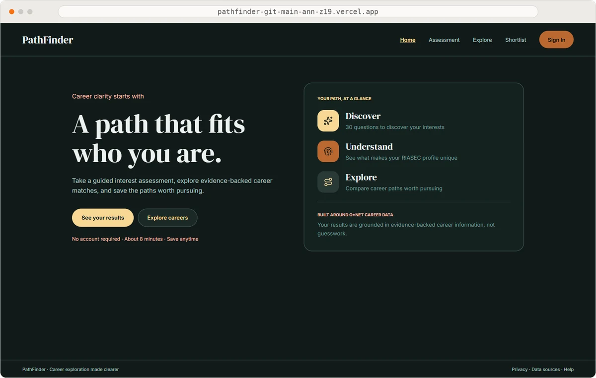
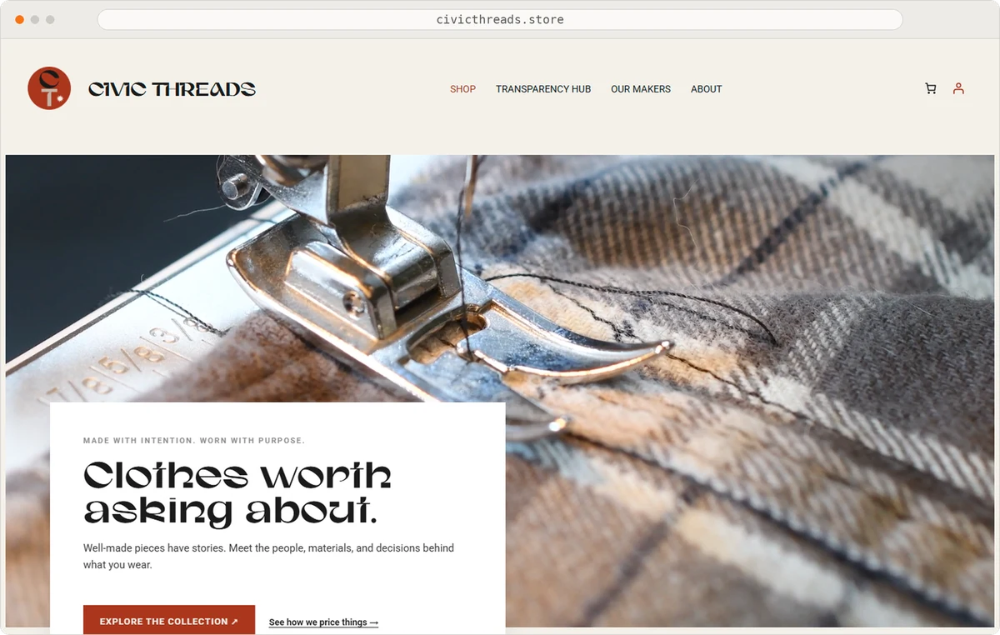
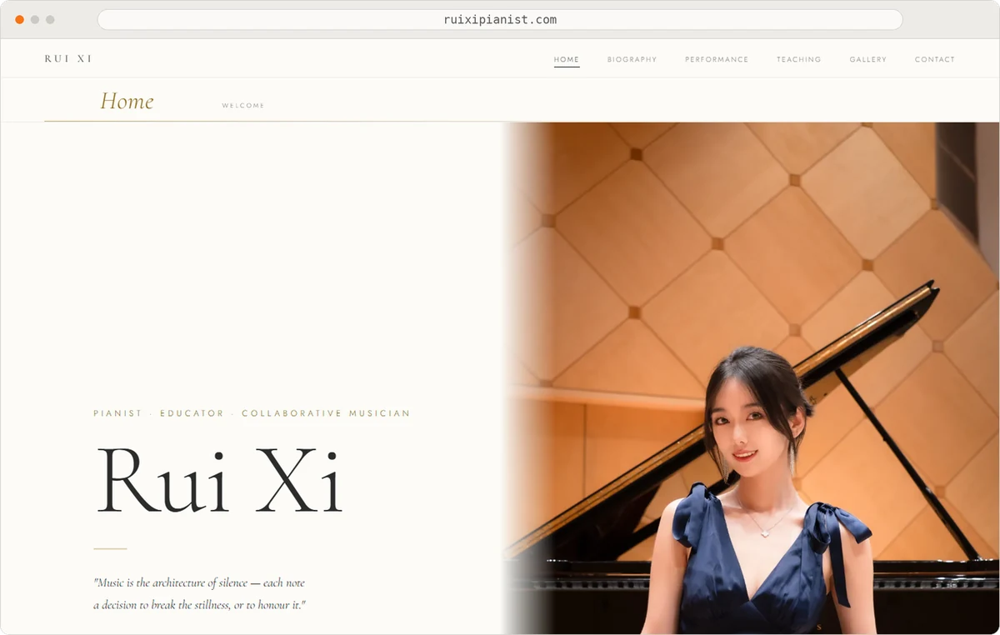

  <picture>
    <source media="(prefers-color-scheme: dark)" srcset="https://readme-typing-svg.demolab.com?font=Fira+Code&weight=600&size=26&pause=1200&color=FB923C&center=true&vCenter=true&width=640&height=60&lines=Hi%2C+I'm+Xuyuan+Zheng;Web+Developer+in+Phoenix%2C+AZ;Responsive+%26+accessible+web+experiences">
    
  </picture>

<b>Xuyuan Zheng</b> · Web Developer · Phoenix, Arizona

<pre>
<b>~/Ann-z19</b> $ tree
.
├── <a href="#whoami">01 · whoami</a>             # about me
├── <a href="#skills">02 · skills/</a>            # tech stack
├── <a href="#projects">03 · projects/</a>          # 3 projects
│   ├── <a href="#pathfinder">PathFinder</a>          # in progress
│   ├── <a href="#civic-threads">Civic Threads</a>       # live
│   └── <a href="#ruixi-pianist">Ruixi Pianist</a>       # live
├── <a href="#experience">04 · experience/</a>        # 2 internships
│   ├── <a href="#ncsl">NCSL</a>                # digital intern
│   └── <a href="#college-leap">College Leap</a>        # web dev intern
└── <a href="#contact">05 · contact</a>            # get in touch
</pre>

## `01` $ whoami

<pre>
├── role       Web Developer
├── based in   Phoenix, Arizona
├── education  B.S. Graphic Information Technology
│              Arizona State University
│              Full-Stack Web Development concentration
│              expected graduation: December 2026
├── builds     responsive websites
│              interactive components
│              CMS integrations
├── focus      accessibility · keyboard navigation
│              focus management · cross-browser testing
└── seeking    entry-level web & software development roles
</pre>

<a href="#top">↑ back to tree</a>

---

## `02` $ ls skills/

<pre>
├── languages/      JavaScript · HTML · CSS
│                   Java · Python · SQL
├── frameworks/     React · Node.js · Express.js
│                   Highcharts · Bootstrap
├── cms-ecommerce/  WordPress · WooCommerce · ACF · DNN CMS
├── dev-qa-tools/   Git · Chrome DevTools · Lighthouse · JUnit
└── deployment/     Netlify · Vercel
</pre>

<a href="#top">↑ back to tree</a>

---

## `03` $ cat projects.md

### PathFinder · `In Progress`

  

<pre>
├── about      a career-exploration app that helps users
│              narrow broad career possibilities into
│              manageable options
├── process    research → planning → interface design
│              → ongoing development
├── features   interest assessment matched with
│              O*NET occupation data
├── stack      React · JavaScript · Node.js · Express.js
│              O*NET Web Services
└── links      <a href="https://github.com/Ann-z19/PathFinder">PathFinder GitHub repository</a>
               <a href="https://pathfinder-git-main-ann-z19.vercel.app/">PathFinder live demo (in progress)</a>
</pre>

### Civic Threads · `Live`

  

<pre>
├── about      team e-commerce site on product costs,
│              sustainability, and product journeys
├── role       Frontend Lead
├── built      Home · Transparency Hub · Shop pages
│              frontend component integration
│              Receipt component: product-specific
│              cost information from ACF data
├── stack      WordPress · WooCommerce · JavaScript
│              PHP · ACF
└── link       <a href="https://civicthreads.store/">Civic Threads live website</a>
</pre>

### Ruixi Pianist · `Live`

  

<pre>
├── about      personal website presenting a pianist's
│              background and teaching information
├── design     elegant visual direction and color palette,
│              refined through the pianist's feedback
├── stack      HTML · CSS · JavaScript · Netlify
├── source     private repository
└── link       <a href="https://ruixipianist.com/">Ruixi Pianist website</a>
</pre>

<a href="#top">↑ back to tree</a>

---

## `04` $ history | grep experience

### Digital Intern · National Conference of State Legislatures

<pre>
├── built      reusable, CMS-configurable interactive
│              map component (JavaScript + Highcharts)
└── a11y       accessibility troubleshooting:
               keyboard navigation · focus management
</pre>

### Web Developer Intern · College Leap

<pre>
├── migrated   20+ pages from Wix to a custom
│              responsive website (HTML · CSS · JS)
├── shipped    deployment configuration
│              responsive, cross-browser, and
│              accessibility testing
└── Link       <a href="https://collegeleap.us/">College Leap website</a>
</pre>

<a href="#top">↑ back to tree</a>

---

## `05` $ contact --list

<pre>
├── linkedin   <a href="https://www.linkedin.com/in/xuyuan-z19902">My LinkedIn Profile</a>
├── email      <a href="mailto:0919xuz@gmail.com">0919xuz@gmail.com</a>
└── portfolio  coming soon
</pre>